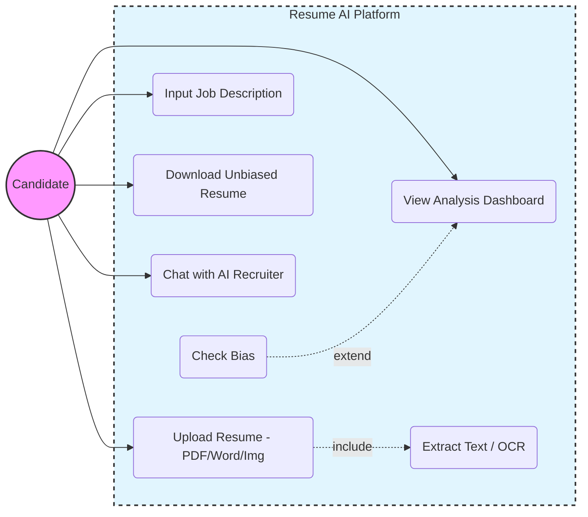
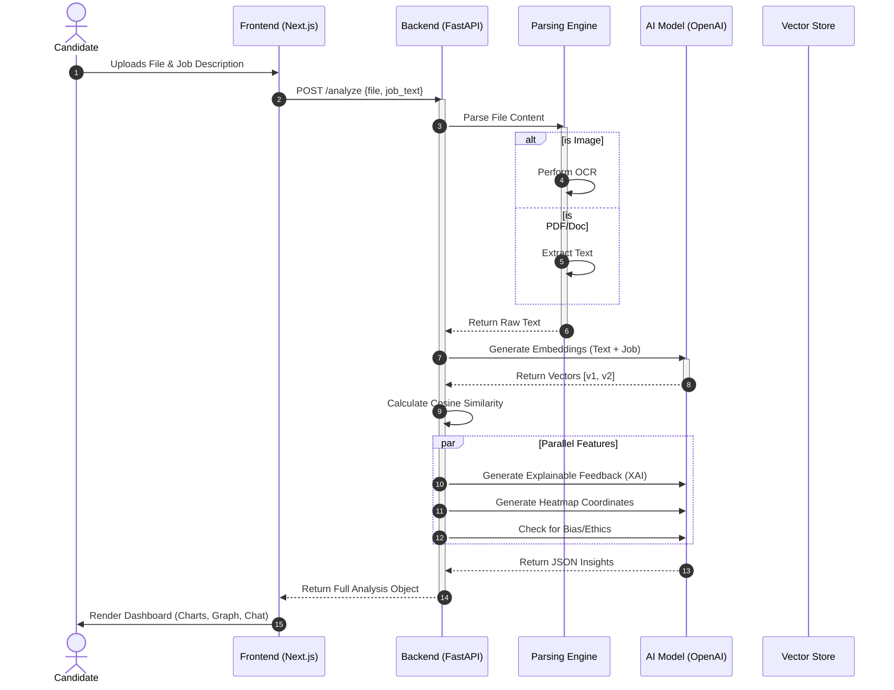
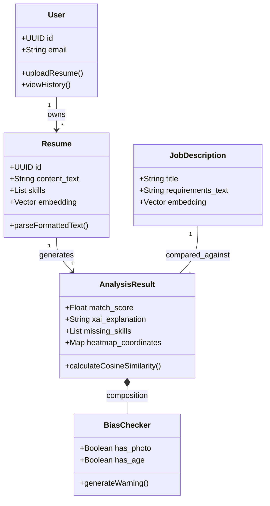
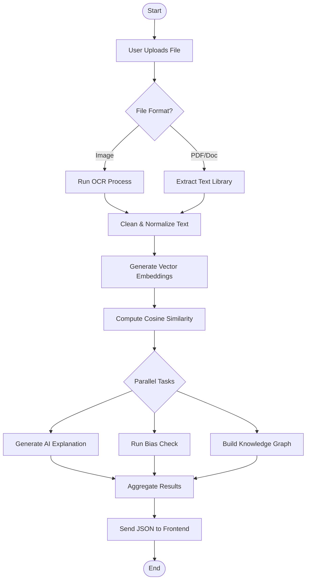

# Technical Architecture & Design Document

## AI-Driven Explainable Resume Analytics Platform

### 1. Executive Summary

This document outlines the technical architecture for an intelligent platform designed to revolutionize recruitment transparency. By leveraging Large Language Models (LLMs) and Vector Space Modeling, the system moves beyond keyword matching to Semantic Understanding and Explainable AI (XAI), addressing the core research problem of "Black Box" hiring algorithms.

---

### 2. Technology Stack Strategy

#### 2.1 Frontend Layer (User Experience)

- **Framework:** **Next.js 14 (React)** - Chosen for its strong SEO and SSR.
- **Styling:** **Tailwind CSS** - For modern, responsive design.

#### 2.2 Backend Layer (Compute)

- **Framework:** **FastAPI (Python)** - Asynchronous, high-performance API.
- **Libraries:** `pdfplumber`, `python-docx` (Parsing), `scikit-learn` (ML).

#### 2.3 AI Layer (Intelligence)

- **Engine:** **GPT-4o** (Reasoning) + **OpenAI Embeddings**.
- **Logic:** **Cosine Similarity** for semantic matching.

---

### 3. System Architecture (Detailed UML Specifications)

_Below are the technical specifications for the diagrams. You can copy these codes into any Mermaid editor to generate the visuals._

#### 3.1 Use Case Diagram

**Description:** Defines the interactions between the Candidate and the System features.
_(Using robust flowchart syntax to ensure visibility)_

#### 3.2 Sequence Diagram

**Description:** The complete flow of a resume analysis request.

#### 3.3 Class Diagram

**Description:** The internal data structure and Object-Oriented design.

#### 3.4 Activity Diagram

**Description:** The decision logic flow for the entire process.

---

### 4. Mathematical Foundation

The system implements the **Vector Space Model** defined in Chapter 2:

**Similarity(A, B) = (A · B) / (||A|| × ||B||)**

Where:

- **A**: Vector representation of the candidate's content.
- **B**: Vector representation of the job description.
- The result is a semantic score (0.0 to 1.0).

---

### 5. Ethical & Privacy

- **Bias Checker:** Automatically flags PII (images, age) to prevent algorithmic bias.
- **Privacy:** No personal data is stored permanently (Stateless).
